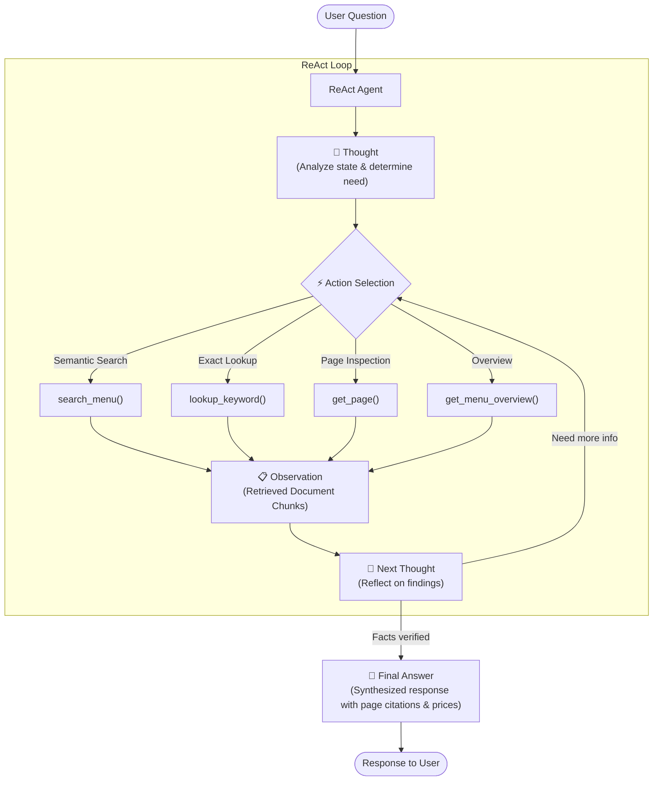

# 🤖 ReAct Agentic RAG with Google Gemini & PDF Tools

An Agentic RAG (Retrieval-Augmented Generation) system utilizing the **ReAct (Reasoning and Action)** paradigm with the **Google Gemini API** (`google-genai` SDK v2) to retrieve and answer questions from the document `rag_file.pdf` (Amman Hotel Menu).

---

## 🏗️ Architecture & ReAct Workflow

The ReAct pattern alternates between **Reasoning (Thought)** and **Action (Tool Execution)** until it has verified all necessary facts to synthesize a final cited response:



---

## 🛠️ RAG Tools Available to the Agent

The agent is equipped with 4 specialized retrieval tools defined in [`rag_tools.py`](file:///c:/Users/elaya/Desktop/Yellowmatics/Agentic%20AI/RAGD3/rag_tools.py):

| Tool Name | Type | Description | Best Used For |
| :--- | :--- | :--- | :--- |
| `search_menu(query)` | Vector Semantic Search | Uses Gemini `text-embedding-004` dense vector embeddings and cosine similarity | Natural language and conceptual queries (e.g. *"spicy starters"*, *"cold drinks"*) |
| `lookup_keyword(keyword)` | Exact/Keyword Search | Fast in-memory token and substring matching | Specific dishes, ingredients, or prices (e.g. *"Paneer Tikka"*, *"Mutton"*) |
| `get_page(page_number)` | Full-Page Retrieval | Returns complete text of a page (1 to 4) | Broad category inspection or reading full menus |
| `get_menu_overview()` | Metadata & Overview | Returns page statistics and category breakdowns | High-level questions regarding the menu structure |

---

## 📁 Project Structure

```
RAGD3/
├── .env                  # Environment file (add your GEMINI_API_KEY here)
├── .env.example          # Example environment template
├── rag_file.pdf          # Target document (Amman Hotel Menu)
├── requirements.txt      # Project dependencies
├── config.py             # Configuration & Gemini client factory
├── document_processor.py # PDF extraction, chunking, caching & vector search
├── rag_tools.py          # Tools exposed to the ReAct agent
├── react_agent.py        # ReAct Agent loop (Thought -> Action -> Observation)
├── main.py               # Interactive CLI application
├── test_rag.py           # Unit and integration test suite
└── .rag_cache/           # Local cache for vector embeddings (auto-generated)
```

---

## 🚀 Quick Start Guide

### 1. Set your Gemini API Key in `.env`
Open [`.env`](file:///c:/Users/elaya/Desktop/Yellowmatics/Agentic%20AI/RAGD3/.env) and paste your Gemini API key:
```env
GEMINI_API_KEY=AIzaSy...
```
*(Get a free Gemini API key from [Google AI Studio](https://aistudio.google.com/app/apikey)).*

### 2. Run the Interactive CLI
Launch the interactive ReAct agent:
```bash
python main.py
```

### 3. Run a Single Direct Query
```bash
python main.py --query "What chicken starters are available and how much do they cost?"
```

### 4. Run the Test Suite
```bash
python test_rag.py
```

---

## 💡 Example Queries to Try

1. *"What mutton dishes are available and what are their prices?"*
2. *"List all vegetarian paneer items with their prices."*
3. *"What fresh juices cost ₹ 120 or less?"*
4. *"Does the menu offer any Chef's Starter Special platters? Give names and prices."*
5. *"What are the total item counts by category across the menu?"*

---

## ⚡ Performance Optimization
- **Embedding Cache**: Chunks and embeddings are cached in `.rag_cache/embeddings_cache.json`. When you restart the application, it loads instantly without recalculating embeddings or consuming Gemini API quota.
- If you modify `rag_file.pdf`, the system detects the hash change and automatically rebuilds the index.
- You can force a re-index at any time using `python main.py --reindex` or typing `reindex` in the interactive console.
